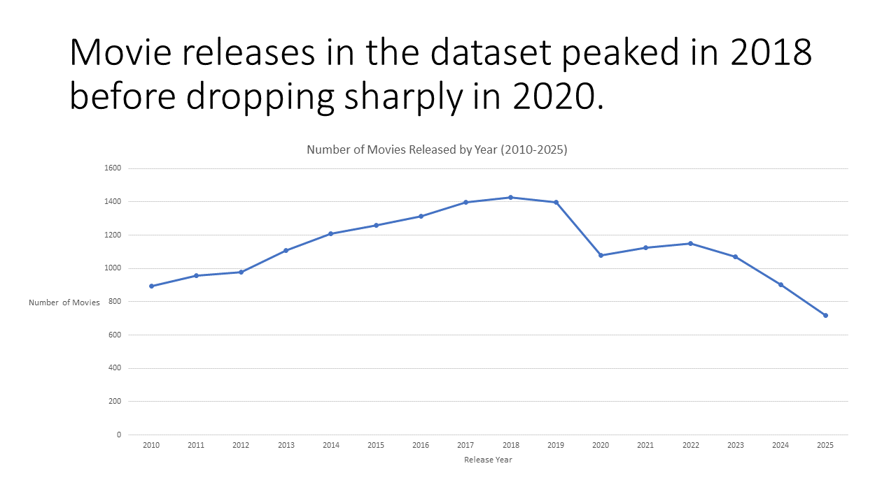
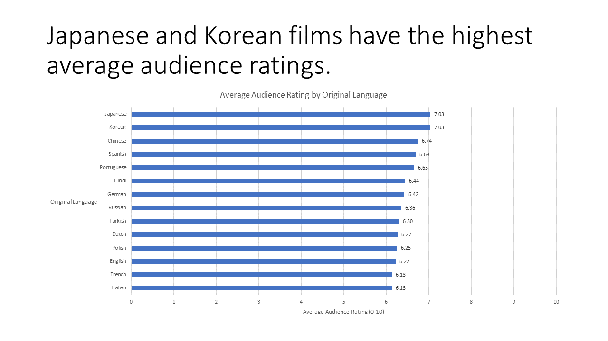
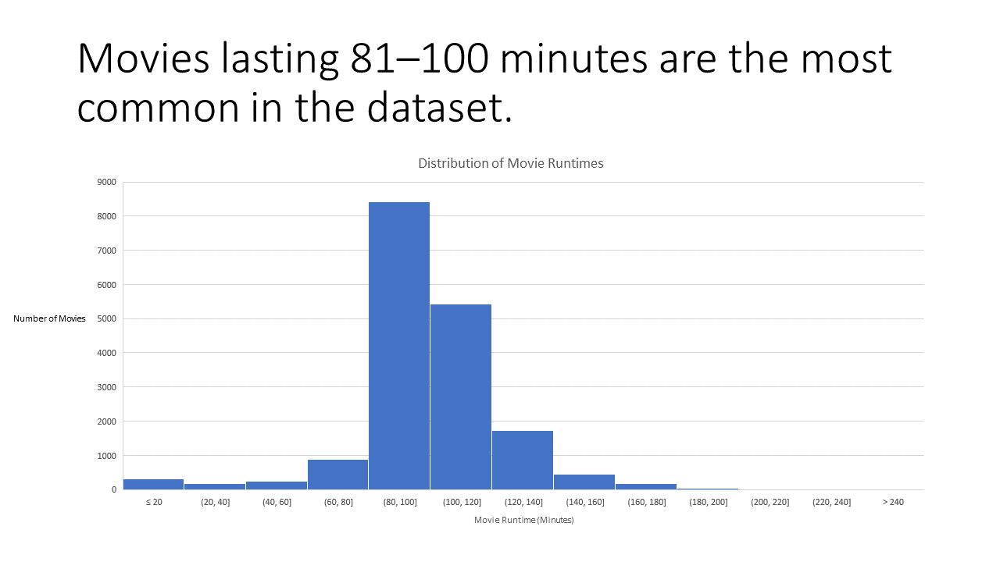
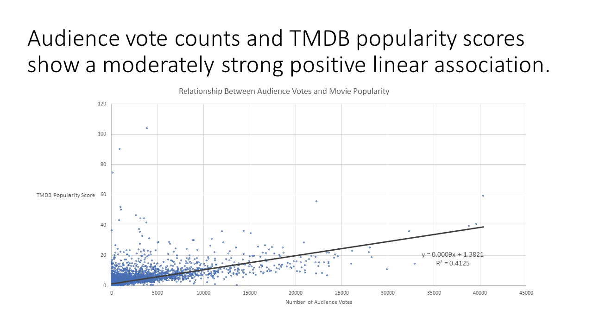

## Project Overview

This project examines trends in the movie industry using four data visualizations created in Microsoft Excel. Our team investigated changes in annual movie releases, differences in audience ratings across original languages, the distribution of movie runtimes, and the relationship between movie popularity and audience engagement.

Each research question was analyzed using a different visualization method: a time-series graph, a bar chart, a histogram, and a scatter plot. The findings were presented using assertion-evidence slides in Microsoft PowerPoint.

## Team Members

- Connor Morris — [ePortfolio](https://cmorris921.github.io/)
- Artemio Perez — [ePortfolio](https://artemioperez1547246.github.io/)
- Tyler Johnson — [ePortfolio](https://tjohnson11-uark.github.io/)
- Kieran Reilly — [ePortfolio](https://kieranreilly.github.io/)
- Jack Davis — [ePortfolio](https://jackd029.github.io/)

## Dataset Description

Our team used the *TMDB Raw Movie Dataset (2010–2025)*, available through Zenodo.

The dataset contains 17,978 movie records covering releases from 2010 through 2025. It includes information such as movie release dates, original languages, audience ratings, runtimes, popularity scores, and audience vote counts.

These variables allowed us to investigate trends in movie releases, compare audience ratings across language groups, examine common movie lengths, and evaluate the relationship between popularity scores and audience votes.

**Dataset Source:** [TMDB Raw Movie Dataset (2010–2025)](https://zenodo.org/records/21920642)

## Visualization 1: Movie Releases Over Time

### Research Question

How has the number of movies released each year changed from 2010 to 2025?

### Why This Question Interests Us

We were interested in how the filmmaking industry has evolved over time, particularly as advancements in technology have made filmmaking equipment more accessible to independent filmmakers and smaller production teams. Although expensive equipment can offer production advantages, creating a compelling film does not necessarily require the most expensive cameras or resources.

We wanted to investigate how the number of movies released each year varied during this period. We were also interested in the effects of the COVID-19 pandemic, which disrupted film production and delayed many releases in 2020.

### How We Used Excel

We used the `release_date` column to determine the release year of each movie. We then counted the number of movies associated with each year from 2010 through 2025.

These annual counts provided the data needed to construct a time-series graph showing how the number of movie records changed throughout the period.

### Visualization Development and Findings

We selected a line graph because it effectively illustrates changes in numerical values across chronological time.

The horizontal axis represents release years from 2010 through 2025, while the vertical axis represents the number of movies released in each year.

The graph shows that the number of movies represented in the dataset increased during the earlier years, reaching a peak of 1,426 movies in 2018. The count subsequently declined, including a noticeable decrease in 2020.

We emphasized the 2018 peak and the 2020 decline in our assertion-evidence slide. Although the decrease around 2020 is consistent with disruptions caused by the COVID-19 pandemic, this visualization alone cannot establish how much of the decline was directly caused by the pandemic.

## Visualization 2: Audience Ratings by Original Language

### Research Question

How do average audience ratings differ between movies of different original languages?

### Why This Question Interests Us

Movies are produced in many different languages, and audiences around the world have access to films created in different countries and cultural contexts.

We were interested in exploring whether audience ratings differ significantly between movies of different original languages or whether their average ratings are relatively similar.

Comparing these ratings also provides an opportunity to examine how movies from different language groups are received by audiences represented in the dataset.

### How We Used Excel

We used the `original_language` and `vote_average` columns to compare audience ratings across language groups.

Using an Excel PivotTable, we calculated the average audience rating for each original language and counted how many movies belonged to each group.

To avoid basing comparisons on languages represented by very few movies, we included only languages with at least 100 movies in the dataset. This resulted in 14 language groups.

### Visualization Development and Findings

We selected a horizontal bar chart to make it easy to compare average ratings across the 14 original languages.

The bars were arranged from highest to lowest average rating, with the highest-rated languages appearing at the top. We displayed the average ratings to two decimal places and used a horizontal rating scale from 0 to 10.

Japanese and Korean movies had the highest average ratings, both approximately 7.03 out of 10. Chinese-language films followed with an average of approximately 6.74.

These results describe the movies represented in this dataset and should not be interpreted as evidence that films produced in any particular language are inherently better than others.

## Visualization 3: Distribution of Movie Runtimes

### Research Question

What is the distribution of movie runtimes?

### Why This Question Interests Us

We were interested in the differences between shorter movies and longer theatrical releases. Many movies are commonly associated with runtimes of approximately 90 minutes, but some prominent modern releases are considerably longer. For example, *Avengers: Endgame* runs for more than three hours, while *Zack Snyder's Justice League* runs for approximately four hours.

These examples made us curious about how typical movie runtimes compare with particularly long films and whether longer runtimes are common throughout the dataset.

### How We Used Excel

We used the `runtime` column to examine the distribution of movie lengths.

During data preparation, we identified 46 movies with runtimes recorded as zero minutes. Because these values appeared to represent unspecified or undocumented runtimes rather than actual movie lengths, we excluded them from the histogram.

This left 17,932 movies with positive runtime values for analysis.

We then created a histogram in Excel using 20-minute intervals to group movie runtimes and count the number of movies in each interval.

### Visualization Development and Findings

We selected a histogram because it shows how frequently different ranges of movie runtimes occur.

The horizontal axis represents movie runtime intervals in minutes, while the vertical axis represents the number of movies in each interval.

The histogram uses 20-minute bins, allowing us to compare the frequency of shorter and longer movies without displaying every individual runtime value.

The most common runtime interval was 81–100 minutes. The distribution also shows that movies with considerably longer runtimes exist, but become less frequent as runtime increases.

Our assertion-evidence slide emphasizes the most common runtime interval, providing a straightforward summary of the distribution.

## Visualization 4: Audience Votes and Movie Popularity

### Research Question

Is there a relationship between a movie's popularity score and the number of audience votes it receives?

### Why This Question Interests Us

Popular movies often attract greater public attention and discussion, which may encourage more people to watch and rate them. However, a movie receiving many audience votes does not necessarily mean that it has a high popularity score.

We wanted to investigate whether movies with higher audience vote counts also tend to have higher TMDB popularity scores, and how consistently these two measures are associated.

### How We Used Excel

We used the `vote_count` and `popularity` columns from the movie dataset.

In Excel, we created a scatter plot with audience vote counts on the horizontal axis and TMDB popularity scores on the vertical axis. Each plotted point represents a movie in the dataset.

We also added a linear trendline to summarize the overall relationship between the two variables. Excel provided the trendline equation and coefficient of determination (R²).

### Visualization Development and Findings

We selected a scatter plot because it allows us to examine the relationship between two numerical variables and identify patterns, clusters, and outliers.

The data show a positive association between audience vote counts and TMDB popularity scores, meaning that movies receiving more audience votes generally tend to have higher popularity scores.

The fitted linear regression equation is:

**Popularity = 0.0009 × Vote Count + 1.3821**

The coefficient of determination is **R² = 0.4125**, indicating that the linear model explains approximately 41.25% of the variation in popularity scores within the dataset.

The corresponding Pearson correlation coefficient is approximately 0.642, indicating a moderately strong positive linear association.

Although the trend is positive, the scatter plot also contains considerable variation and some outliers. The relationship does not establish that receiving more audience votes directly causes a movie's popularity score to increase.

